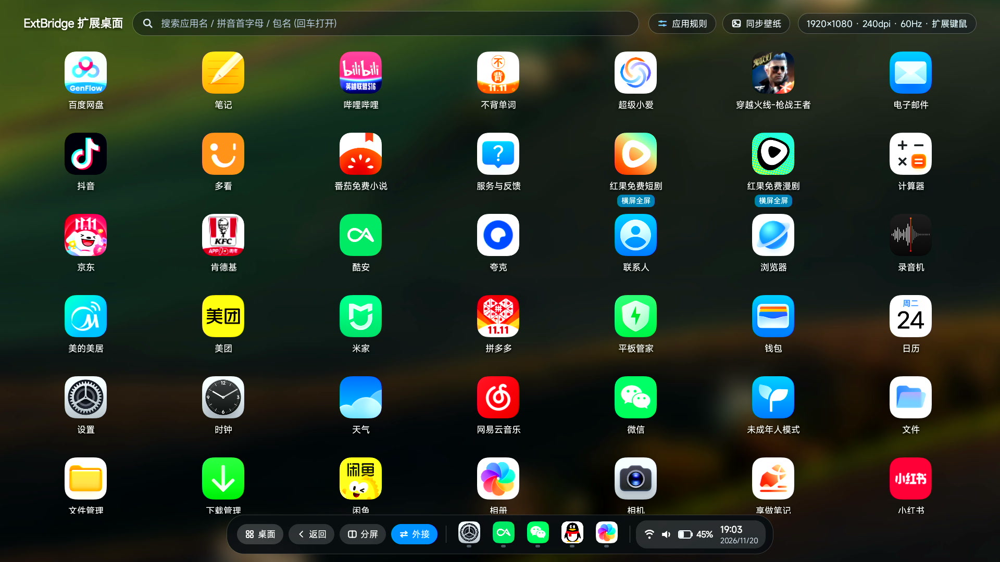
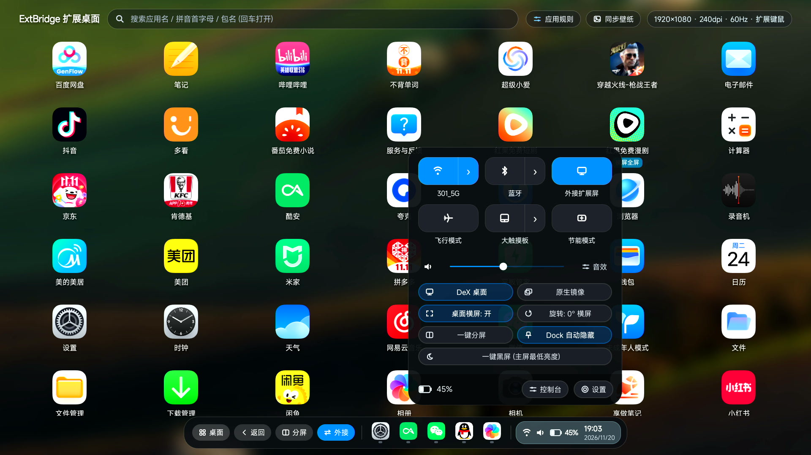
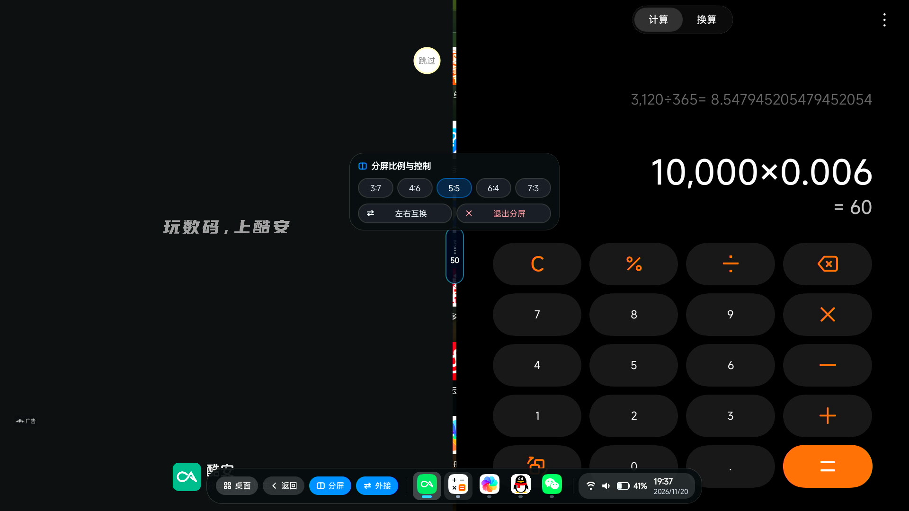
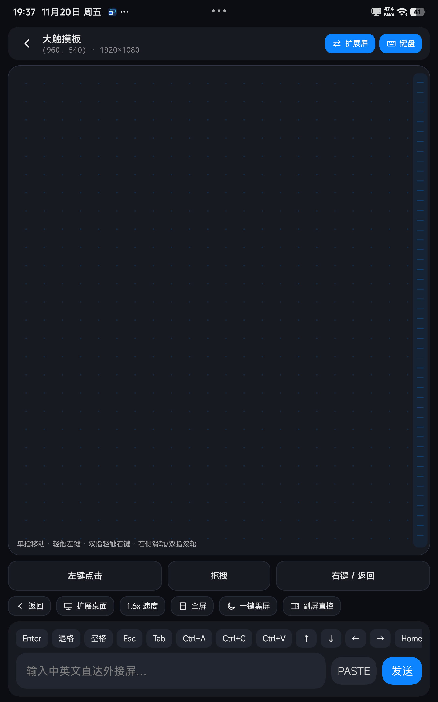
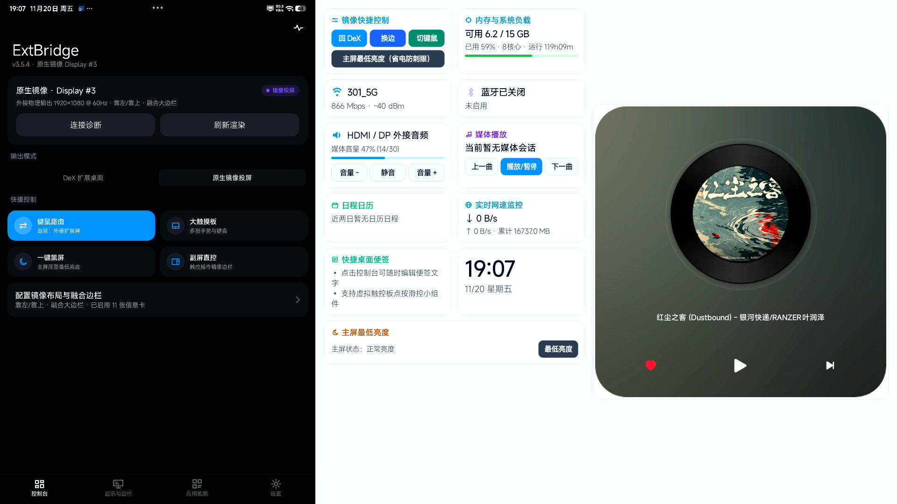
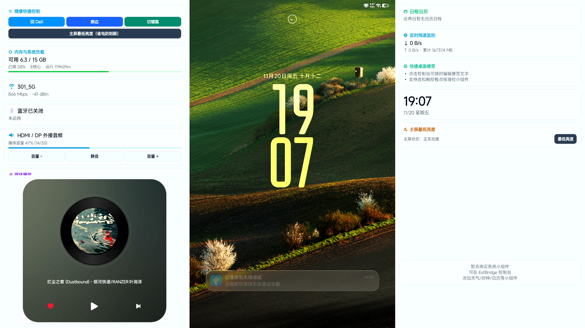
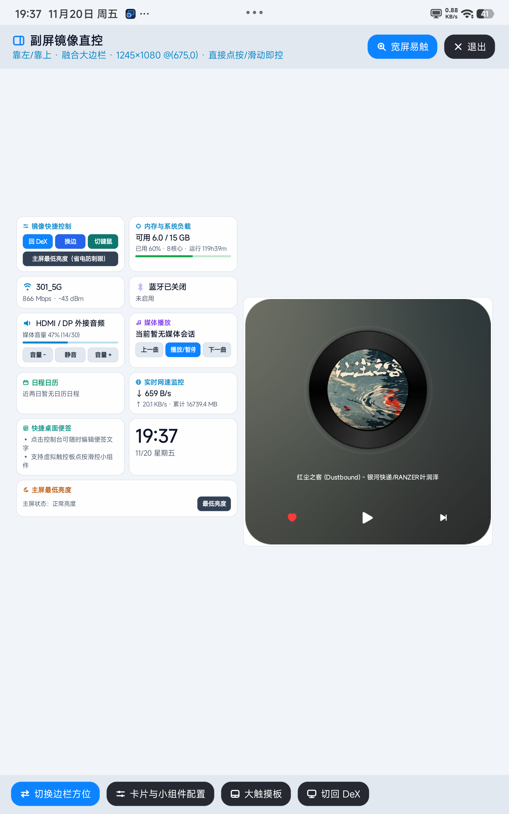

# ExtBridge (`v3.5.5`) — Android 免 Root Type-C 类 DeX 扩展桌面与增强镜像副屏系统

> **无需 Root · 单个 APK 自激活 · Xiaomi HyperOS 原生澎湃视觉 (`Compose + Miuix`) · 支持「DeX 独立扩展桌面」与「增强原生镜像信息副屏」双工作模式 · [📖 完整图文使用说明书](docs/USER_GUIDE.md) · [📝 v3.5.3 更新文档](docs/RELEASE_v3.5.3.md)**

许多 Android 手机与平板（如小米 / REDMI 在 HyperOS 下）连接 Type-C 显示器时，默认仅提供画面受限的**屏幕镜像（Mirroring）**，主屏与副屏比例割裂且两侧留下大片空白黑边。**ExtBridge** 通过 Shell 权限守护进程接管外接物理屏，不仅能够呈现类似 Samsung DeX 的**独立扩展桌面、自由分屏与一键主屏黑屏省电**，还能将传统镜像模式下多出的黑边改造为**支持主题换肤、系统桌面小组件、交互控制与外置鼠标自由跨屏的增强信息侧边栏**。

---

## ✨ 核心特性 & 新增功能全览 (`v3.5.5`)

### 0. 🎨 全新 Xiaomi HyperOS 原生澎湃界面重构、舞台动效与全周边联动 (`v3.5.5`)
- **主控台与大触摸板 (`Jetpack Compose + Miuix 0.9.4`)**：彻底告别单页臃肿堆砌与彩虹按钮，支持 **平板横屏左侧 `NavigationRail` 双栏工作台** 与 **手机竖屏可折叠大标题 `TopAppBar` + 底部四栏 `NavigationBar`** 自适应切换，内置**跟随系统 / 澎湃浅色 / 澎湃深色**三态外观；提供 `2×2` 控制中心快捷磁贴、可视化镜像布局示意图、关键点吸附 DPI 滑块与独立一级「分应用显示规则」搜索页。
- **HyperOS 2.0 级窗口最小化/恢复与分屏过渡动画 (`StageTransitionView`)**：新增跨进程零拷贝 `HardwareBuffer` `TaskSnapshot` 快照通道，支持点击 Dock 图标退回后台微弧收缩形变、后台应用弹簧展开、分屏比例切换双窗同步形变与左右/上下互换立体交叉动画。
- **全周边界面线性矢量联动（零 Emoji）**：外接屏 DeX 底部 Dock、HyperOS 风格 `#0D84FF` 快捷控制中心浮窗、自由分屏比例菜单、扩展桌面启动器顶栏、`SideControlActivity` 副屏直控以及镜像边栏全部 14 款预设信息卡片均统一采用抗锯齿线性矢量图标与澎湃圆角卡片视觉。

### 1. 🖥️ 增强原生镜像模式：把黑边改造成「信息副屏 + 小组件工作台」
针对 `16:10` / `3:2` 平板或手机镜像至 `16:9` 显示器产生的左右黑边，ExtBridge 原生镜像模式现已全面重塑为**可定制、可交互的信息扩展副屏**：
- **4 种画面布局与黑边合并**：支持 **关闭侧边栏 (`0`)**、**镜像右移 · 左侧合并宽边栏 (`1`)**、**镜像左移 · 右侧合并宽边栏 (`2`)** 及 **镜像居中 · 左右双翼对称侧边栏 (`3`)**；可一键将双侧窄黑边合并到单侧，为信息卡片与桌面小组件留出完整宽裕空间，并自动适配不同屏幕分辨率与宽高比。
- **14 款可自由替换与排序的预设信息组件**：
  - `🕒 大数字时钟`（高对比超大字号时间与星期日期） / `📅 日历与近期日程`
  - `🔋 电池温压详情`（电量、充放电功耗、温度与电压） / `⚡ 内存与系统负载`（可用 RAM 与系统运行负载）
  - `📶 Wi-Fi 与信号`（SSID、实时速率与 `dBm` 强度） / `🌐 实时网速监控`（每秒上行/下行吞吐速率）
  - `🎧 蓝牙与外设`（耳机/键鼠连接状态） / `💾 存储与亮度信息`（机身可用空间与当前亮度）
  - `🔊 音频通道与音量`（显示 `HDMI / DP 外接音频` 等路由通道，支持直接点按 `➖ / 🔇 / ➕`）
  - `🎵 媒体播放与切歌`（当前播放曲目/App，支持点按 `⏮ / ⏯ / ⏭` 切歌控制）
  - `⏱ 专注番茄钟`（25 分钟倒计时，边栏直接启停/重置） / `📝 快捷桌面便签`（随手显示待办备忘）
  - `🎛 镜像快捷控制台`（一键切回 DeX / 切换对齐方位 / 切换键鼠 / 极暗） / `🌙 主屏最低亮度`（一键压低主屏背光至硬件最低 `1`，再点恢复）
- **系统桌面小组件 (`AppWidget`) 接入与防拉伸保护**：
  - 支持在镜像副屏左/右槽位绑定任意系统/第三方 App 小组件（如音乐播放器、天气、日程），并针对小组件在非标准侧边栏中容易被异常拉长变形的问题，内置 **5 档显示比例约束**（`自动原比例` / `方形 1:1` / `竖屏 3:4` / `宽屏 16:9` / `铺满槽位`），保持比例协调不失真。
- **6 款视觉主题 + 自定义纯色底纹**：
  - 支持 **`极夜深蓝`**、**`OLED纯黑`**、**`晨雾浅白`**、**`赛博紫青`**、**`翡翠墨绿`**、**`暖暮琥珀`** 及 **`自定义颜色`**，大字号高对比排版适应各种观影与办公环境。
- **外置鼠标无缝跨屏 & 无键鼠「副屏直控」**：
  - **外置鼠标外屏显示与跨屏自由点按**：外接实体鼠标不仅能在镜像模式下正常显示于外接屏，将鼠标指针滑向镜像区左右边缘即可无缝跨入黑边侧边栏点按、滚轮或右键操作小组件（已修复边缘碰触误弹出 ExtBridge 主界面的问题与捕获重入保护）。
  - **5 档副屏光标灵敏度调节**：针对镜像侧边栏与不同分辨率显示器提供 **`0.9x 精细`** / **`1.4x 标准`** / **`1.9x 流畅`** / **`2.6x 极速`** / **`3.4x 飞快`** 五档指针倍速及 DPI 自适应缩放，解决低/高分辨率屏幕下鼠标过慢或过飘问题。
  - **App 内「副屏直控」(`SideControlActivity`) + 触控板互操**：没有外置键鼠时，可在主控制台或虚拟触摸板一键打开 **`副屏直控`**，直接在平板/手机主屏手指点选滑动镜像侧边栏（也可通过虚拟触控板直接点按操作已添加的小组件）；同步保留**平板桌面布局保护**，不破坏原主屏桌面排版。

### 2. 🖥️ DeX 独立扩展桌面模式 + 21:9 带鱼屏自适应 + 一键主屏黑屏省电
- 自动探测外接物理显示器 (`Display.TYPE_EXTERNAL`) 并通过 `SurfaceControl` 投射独立的 `VirtualDisplay`（首次接入自动从 EDID 优先识别最高原生宽屏/高刷物理分辨率与适配 DPI，避免 3:2 平板默认回落到 4:3/16:9 留黑边）。
- **独立「桌面渲染分辨率」调节与四向旋转（`0° / 90° / 180° / 270°`）**：内置 `3840×2160 (4K)`、**`3440×1440 (21:9 准4K带鱼)`**、`2560×1600`、`2560×1440`、**`2560×1080 (21:9 带鱼)`**、`1920×1200`、`1920×1080`、`1600×900`、`1280×720` 预设及自定义宽高比，「恢复推荐默认」自动匹配当前显示器最佳原生 EDID 分辨率。
- **自适应自动隐藏 Dock 栏 & Win11 风格控制浮窗 (`BridgeService`)**：进入应用闲置约 `2.6s` 自动收起为底边触控条（鼠标悬停底边唤醒）。
- **🌙 一键黑屏（平板/手机主屏最低亮度熄屏护眼）**：在 Dock 快捷控制浮窗点击 **「🌙 一键黑屏 (平板最低亮度)」**，主屏立即叠加纯黑防误触遮罩（支持 `NavAssistService` 无障碍层级兜底）并将背光精准降至硬件最低 `1`；**双击主屏任意位置**、关闭服务或断开外接屏时均自动精确恢复进入前的亮度。

### 3. ◫ DeX 自由分屏模式 & 分应用显示兼容策略（含防工作台小窗劫持保护）
- **横屏自动左右分屏 / 竖屏自动上下分屏**：Dock 一键分屏或桌面图标长按/右键放入左/右/上/下屏；中央高对比度拖拽分割条支持 **`25% ~ 75%`** 实时调节比例与快捷预设（`3:7 / 4:6 / 5:5 / 6:4 / 7:3`、`⇄/⇅ 互换`、`✕ 退出`）。
- **三档分应用兼容策略 + 防悬浮小窗劫持**：支持 *跟随系统默认 / 强制横屏全屏 / 竖屏居中兼容*（配置持久化于 `/data/local/tmp/extbridge_apps.conf`），同时针对开启了小米「工作台模式（无界桌面）」或系统「强制桌面模式」的设备自动锁定扩展屏 `WINDOWING_MODE_FULLSCREEN` 容器，防止桌面与应用被系统误塞进鼠标无法拖拽的 `•••` 悬浮小窗。

### 4. 📱 虚拟触摸板与键盘输入转发 + 单 APK 多模自激活
- **增强虚拟触摸板 (`TouchpadActivity`)**：支持单指移动、轻触左键、双指右键、双指/右边缘滚动、拖拽锁定开关、`0.6x ~ 2.4x` 指针灵敏度调节、一键直达「副屏直控」，以及呼出主屏软键盘将输入文字/回车/退格转发给外接屏焦点应用。
- **单 APK 多模自激活**：APK 内置 `extbridge.jar`（**已移除**内置 `libadb.so`），支持 **Shizuku 一键激活（免无线调试、免 6 位配对码，最推荐）**、**电脑 ADB 一键激活** 与 **已 Root 设备静默降权激活 (`uid=2000 shell`)**。

---

## 📸 实机功能效果展示（更多细节见 [使用说明书](docs/USER_GUIDE.md)）

| DeX 独立扩展桌面 & Dock | Win11 快捷浮窗 & 一键黑屏入口 | 主屏一键黑屏最低亮度保护 |
| :---: | :---: | :---: |
|  |  |  |

| 短剧等应用强制横屏全屏 | DeX 50/50 自由分屏模式 | 手机/平板端增强虚拟触摸板 |
| :---: | :---: | :---: |
|  |  |  |

| 增强镜像 · 统一左侧信息栏 + 小组件 | 增强镜像 · 左右双翼侧边栏 | 无键鼠时主屏「副屏直控」小组件 |
| :---: | :---: | :---: |
|  |  |  |

---

## 🏗️ 整体架构与目录结构

```text
├── bridge/                                  # Shell 权限后台守护进程（app_process 启动）
│   └── src/com/extbridge/daemon/
│       └── ExtBridge.java                   # 物理屏接管、VirtualDisplay/SurfaceControl 投射、
│                                            # Binder IPC (UID ACL 鉴权)、分屏/键鼠跨屏注入、亮度管理
├── helper/                                  # Android 客户端 App (com.extbridge.helper · Kotlin + Compose + Miuix)
│   ├── build.gradle.kts                     # AGP 9 + Compose + Miuix 0.9.4 + R8 瘦身配置 (v3.5.5 / code 27)
│   ├── AndroidManifest.xml                  # 清单声明、Shizuku Provider 与 ControlReceiver 契约
│   ├── res/
│   └── src/com/extbridge/helper/
│       ├── MainActivity.kt                  # HyperOS 澎湃风格主控台（响应式双栏/底栏、Miuix 抽屉与分应用规则）
│       ├── TouchpadActivity.kt              # HyperOS 风格大触摸板与远程输入法转发
│       ├── ui/                              # ExtVectorIcons 线性图标库、ExtHyperTheme 与 Miuix 弹窗组件
│       ├── HyperUi.java                     # 原生 View 浮层共享线性矢量图标与澎湃色彩引擎
│       ├── StageTransitionView.java         # HyperOS 2.0 级窗口最小化/恢复与分屏舞台过渡动效引擎
│       ├── LauncherActivity.java            # 外接屏独立桌面启动器（壁纸同步、拼音检索、分屏/兼容菜单）
│       ├── BridgeService.java               # 核心前台服务（澎湃 Dock、控制中心浮窗、黑屏遮罩、镜像信息栏、光标）
│       ├── SideControlActivity.java         # 主屏镜像「副屏直控」交互页面（无键鼠手指点选侧边栏）
│       ├── SideMouseCaptureActivity.java    # 镜像边缘物理鼠标捕获与跨屏边界协同
│       ├── BridgeClient.java                # Binder IPC 客户端封装、主题/预设/比例模型与自动重连
│       ├── BridgeProvider.java              # 零延迟安全分发 Binder 句柄（UID 白名单鉴权）
│       ├── ControlReceiver.java             # `goAsync()` 异步后台广播控制接收器（含发送方 UID 鉴权）
│       ├── NavAssistService.java            # 无障碍辅助服务（高优先级黑屏遮罩、边缘叠加、手势穿透）
│       ├── AdbBootstrap.java                # 守护进程拉起脚本、Root 激活与 Shizuku 特权执行入口
│       ├── ShizukuBootstrap.java            # Shizuku 授权/状态探测与 IShizukuService#newProcess 特权 Shell
├── docs/
│   ├── USER_GUIDE.md                        # 完整图文使用说明书
│   ├── RELEASE_v3.5.3.md                    # v3.5.3 版本发布与更新说明
│   └── images/                              # GitHub 文档实机截图素材
├── .github/workflows/build.yml              # GitHub Actions 云端自动编译打包与 Release 工作流（SHA 锁定与最小权限）
├── THIRD_PARTY_NOTICES.md                   # 第三方开源组件（Compose / Miuix / Shizuku API）许可证声明
├── build_v3.ps1                             # Windows 一键全自动编译打包脚本（extbridge.jar + Gradle R8 Release）
└── start_extbridge.sh                       # 手机/ADB 手动启动守护进程脚本
```

---

## 🚀 快速上手

详细图文步骤与各模式操作说明请阅读 **[📖 docs/USER_GUIDE.md](docs/USER_GUIDE.md)**。

### 核心 3 步：
1. 安装 `ExtBridge_v3.5.5.apk`，首次打开按提示授予 **通知**、**悬浮窗** 与 **无障碍服务 (`ExtBridge 平板辅助手势`)** 权限（小米等设备建议在开发者选项开启「USB 调试（安全设置）」以允许点击注入）。
2. 在激活弹窗中任选其一启动守护进程：
   - **Shizuku 一键激活（最推荐）**：安装并启动 [Shizuku](https://shizuku.rikka.app/download/)，在弹窗 **「Shizuku 激活」** 页点击 **「授权 Shizuku」** → **「Shizuku 一键激活服务」** 即可，**无需开启无线调试、无需输入 6 位配对码**；
   - **电脑 ADB 一键命令**（零宿主变量展开，兼容 Windows CMD / PowerShell 与 Linux / macOS Bash / Zsh）：
     ```bash
     adb shell "rm -f /data/local/tmp/extb_src.apk /data/local/tmp/extbridge.jar.new && pm path com.extbridge.helper | cut -d: -f2 | head -n1 | xargs cat > /data/local/tmp/extb_src.apk && test -s /data/local/tmp/extb_src.apk && unzip -p /data/local/tmp/extb_src.apk assets/extbridge.jar > /data/local/tmp/extbridge.jar.new && rm -f /data/local/tmp/extb_src.apk && test -s /data/local/tmp/extbridge.jar.new && [ "$(head -c 2 /data/local/tmp/extbridge.jar.new)" = "PK" ] && chmod 644 /data/local/tmp/extbridge.jar.new && timeout 6 env CLASSPATH=/data/local/tmp/extbridge.jar.new app_process /data/local/tmp com.extbridge.daemon.ExtBridge --verify-helper >/dev/null 2>&1 && (timeout 8 env CLASSPATH=/data/local/tmp/extbridge.jar.new app_process /data/local/tmp com.extbridge.daemon.ExtBridge --stop >/dev/null 2>&1 || true) && (pgrep -f '^app_process.*ExtBridge' >/dev/null 2>&1 && (pkill -f '^app_process.*ExtBridge' 2>/dev/null || true) && sleep 1 && (pkill -f -l KILL '^app_process.*ExtBridge' 2>/dev/null || true) || true) && rm -f /data/local/tmp/extbridge.jar && mv -f /data/local/tmp/extbridge.jar.new /data/local/tmp/extbridge.jar && test -s /data/local/tmp/extbridge.jar && appops set com.extbridge.helper SYSTEM_ALERT_WINDOW allow && appops set com.extbridge.helper RUN_ANY_IN_BACKGROUND allow && (appops set com.extbridge.helper 10021 allow 2>/dev/null || true) && (appops set com.extbridge.helper ACCESS_RESTRICTED_SETTINGS allow 2>/dev/null || true) && (pm grant com.extbridge.helper android.permission.POST_NOTIFICATIONS 2>/dev/null || true) && (dumpsys deviceidle whitelist +com.extbridge.helper >/dev/null 2>&1 || true) && (CLASSPATH=/data/local/tmp/extbridge.jar nohup app_process /data/local/tmp com.extbridge.daemon.ExtBridge >/data/local/tmp/extbridge.log 2>&1 </dev/null &)"
     ```
   - **已 Root 设备**：一键授权后先切至 `shell (uid=2000)` 校验哈希与证书，守护进程强制降权运行（失败即中止退出）。
3. 插上 Type-C 显示器即可在控制台或快捷栏随时切换 **DeX 独立桌面 / 自由分屏 / 增强原生镜像 / 一键黑屏省电**。

---

## 🛠️ 从源码编译

Windows 下具备 **JDK 17+**（Gradle Toolchain 将自动拉取 JDK 21）与 **Android SDK (`build-tools/37.0.0` + `platforms/android-37.0`)** 即可一键编译：

```powershell
powershell -ExecutionPolicy Bypass -File .\build_v3.ps1
```

输出产物位于 `build\out\extbridge.jar` 与 `build\out\exthelper.apk`。

**签名**：构建会按以下优先级自动选择密钥库（绝不回退 Debug 签名）：
1. `EXTBRIDGE_KEYSTORE` / `EXTBRIDGE_KEYSTORE_PASS` 环境变量（CI 用）；
2. `local.properties` 中的 `keystore.file` / `keystore.alias` / `keystore.type` / `keystore.pass`（本地开发，`local.properties` 已被 git 忽略）；
3. 仓库根目录的 `exthelper.p12`（官方发布证书，会校验 SHA-256 指纹）或 `hzgndz.keystore`（本地自定义证书，JKS，别名自动探测）。

如需无密钥可复现构建校验，可设置 `$env:EXTBRIDGE_ALLOW_UNSIGNED_RELEASE="1"` 生成 `exthelper-unsigned.apk`。完整版本更新历史请见 [CHANGELOG.md](CHANGELOG.md)。

---

## 📖 关于「桌面渲染分辨率」与免 Root 定位

1. **桌面渲染分辨率 (`VirtualDisplay`) vs 外接物理输出 (`EDID`)**：部分设备（如 Xiaomi HyperOS 正式版固件）由系统 `DisplayModeDirectorImpl` / `SurfaceFlinger` 锁死物理输出档位，显示器 OSD 菜单仍显示 `1080p@60` 或 `2K@60`；但 ExtBridge 控制台调节的 **`VirtualDisplay` 实际画布分辨率** 在所有机型上 100% 生效，可真实实现 **720p 降载稳帧省电**、**4K 超采样锐化**、**自由宽高比** 与 **90°/270° 竖屏满铺**。
2. **坚持免 Root 路线**：ExtBridge 不改写系统分区，也不会提供用于 Hook 系统框架或 `SurfaceFlinger` 的 Zygisk/LSPosed Root 模块；如需彻底重置单应用 `am compat` 策略，请在控制台「分应用显示模式」点击 **「↺ 全部重置为默认」**，或执行 `adb shell am compat reset-all <packageName>`。

---

## ⚠️ 开源协议与第三方声明
基于 [MIT License](LICENSE) 开源；第三方开源库（Compose / Miuix / Shizuku API）来源与许可证详见 [THIRD_PARTY_NOTICES.md](THIRD_PARTY_NOTICES.md)。
