# ExtBridge `v3.5.4` 完整图文操作说明书

> **无需 Root · 单 APK 三模自激活 · Xiaomi HyperOS 澎湃原生视觉 (`Compose + Miuix`) · 「DeX 独立扩展桌面」与「增强原生镜像副屏」双工作模式**

本说明书基于 **REDMI K Pad（HyperOS 2）+ 2560×1440 外接显示器** 的全流程实机测试截图编写，覆盖从首次安装授权、三种守护进程激活方式、主控台四大功能页、DeX 独立桌面与自由分屏、增强原生镜像与桌面小组件、虚拟大触摸板与远程键盘转发，到 ADB 自动化广播与故障排查的全部操作细节。

---

## 目录

1. [硬件准备与首次启动权限初始化](#1-硬件准备与首次启动权限初始化)
2. [激活后台核心守护进程（三种方式任选）](#2-激活后台核心守护进程三种方式任选)
3. [HyperOS 澎湃主控台四大页面逐项详解](#3-hyperos-澎湃主控台四大页面逐项详解)
4. [模式一：DeX 独立扩展桌面、澎湃 Dock 与自由分屏](#4-模式一dex-独立扩展桌面澎湃-dock-与自由分屏)
5. [模式二：增强原生镜像副屏、桌面小组件与副屏直控](#5-模式二增强原生镜像副屏桌面小组件与副屏直控)
6. [虚拟大触摸板与远程中英文键盘输入](#6-虚拟大触摸板与远程中英文键盘输入)
7. [ADB / Shizuku / 自动化快捷广播指令手册](#7-adb--shizuku--自动化快捷广播指令手册)
8. [常见问题排查（FAQ）与环境还原指南](#8-常见问题排查faq与环境还原指南)

---

## 1. 硬件准备与首次启动权限初始化

### 1.1 适用设备与线材要求
- **系统版本**：Android 11（API 30）及以上，实测深度适配 **Xiaomi HyperOS 1 / 2 / 3** 平板与手机（如 REDMI K Pad、小米平板 6S Pro、REDMI K90 Pro 等）。
- **视频输出硬件**：设备 Type-C 接口需支持 **USB-C DisplayPort Alt Mode** 视频输出（搭配全功能 Type-C 一线通显示器，或 Type-C 转 HDMI / DP 扩展坞）。

### 1.2 首次打开必授的 3 项基础权限
首次打开 ExtBridge 时，主界面会自动弹出 **「运行权限健康检查」** 引导卡片，请按顺序开启以下三项权限：

1. **通知栏常驻权限 (`POST_NOTIFICATIONS`)**
   - 用于前台显示服务保活与通知栏一键切模式/退服务。
2. **悬浮窗与外接光标权限 (`SYSTEM_ALERT_WINDOW`)**
   - 用于在外接显示器上绘制澎湃 Dock 任务栏、快捷控制中心浮窗、外接鼠标指针、分屏拖拽手柄及镜像信息侧边栏。
3. **无障碍手势与浮层权限 (`ExtBridge 平板辅助手势`)**
   - 用于高优先级主屏「一键黑屏」防误触遮罩及跨屏辅助交互。

> [!IMPORTANT]
> **小米 / HyperOS 用户必看的两项关键系统设置：**
> 1. **解锁灰色的无障碍「受限设置」**：在 Android 13+ 上直接点开无障碍若提示「受限设置」无法开启，请先进入系统 **设置 → 应用设置 → 应用管理 → ExtBridge → 点击右上角 `⋮`（或划到最底部）→ 允许受限设置**，再返回无障碍开启即可（若使用电脑 ADB 或 Root 方式激活，脚本也会自动为你解锁该项）。
> 2. **开启「USB 调试（安全设置）」以允许点击注入**：请前往 **设置 → 更多设置 → 开发者选项**，同时打开 **「USB 调试」** 与下方的 **「USB 调试（安全设置）— 允许通过 USB 调试修改权限或模拟点击」**。若未开启此项，使用虚拟触摸板或副屏跨屏鼠标时会出现「光标能移动但点击图标无反应」，主控台顶部也会显示红色拦截提示。

---

## 2. 激活后台核心守护进程（三种方式任选）

由于 ExtBridge 坚持**免改系统分区、免 Root 路线**，接管外接物理屏的守护进程（`ExtBridge`）以系统 `shell (uid=2000)` 权限驻留运行。**设备每次重启后需重新激活一次**（平时插拔显示器或关闭屏幕无需重复激活）：

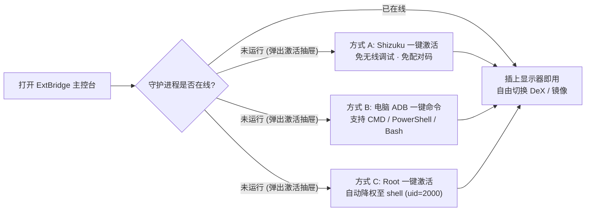

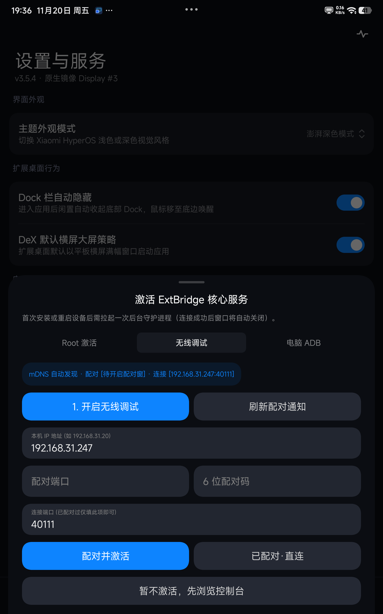

### 方式 A：Shizuku 一键激活（最推荐，免无线调试、免配对码）
ExtBridge 通过 [Shizuku](https://shizuku.rikka.app/download/) 直接以系统 `shell (uid=2000)`（Root 启动的 Shizuku 则为 `root`）身份拉起守护进程，**不再需要开启无线调试，也不需要输入 6 位配对码**：

- **首次激活（约 10 秒完成）**：
  1. 安装并启动 **Shizuku**（Android 11+ 可在 Shizuku 内通过「无线调试」自行启动，已 Root 设备可直接以 Root 方式启动）；
  2. 在 ExtBridge 激活抽屉切到 **「Shizuku 激活」** 页，顶部会实时显示 Shizuku 服务与授权状态；
  3. 点击 **「授权 Shizuku」**，在 Shizuku 弹窗中允许 ExtBridge；
  4. 点击 **「Shizuku 一键激活服务」**，约 2~5 秒自动释放 `extbridge.jar` 并拉起守护进程，成功后弹窗自动收起。
- **重启或 Shizuku 重新启动后**：只要 Shizuku 服务在运行，打开 ExtBridge 会自动静默激活（可在设置中关闭「启动时自动 Shizuku 激活」）。

> [!TIP]
> **若未安装 Shizuku**：可先到 [Shizuku 官网](https://shizuku.rikka.app/download/) 安装并按引导启动服务，或直接使用下方的**电脑 ADB** / **Root** 两种激活方式。

---

### 方式 B：免 Root · 电脑 ADB 一键命令激活
将平板/手机连上电脑 ADB 后，在激活抽屉切到 **「电脑 ADB」** 点击复制命令（或直接复制下方命令），在 **Windows CMD / PowerShell** 或 **macOS / Linux Bash / Zsh** 终端直接粘贴回车即可（若电脑连了多台设备，请在 `adb` 后加上 `-s <设备序列号>`）：

```bash
adb shell "rm -f /data/local/tmp/extb_src.apk /data/local/tmp/extbridge.jar.new && pm path com.extbridge.helper | grep '^package:' | cut -d: -f2 | head -n1 | xargs cat > /data/local/tmp/extb_src.apk && test -s /data/local/tmp/extb_src.apk && unzip -p /data/local/tmp/extb_src.apk assets/extbridge.jar > /data/local/tmp/extbridge.jar.new && rm -f /data/local/tmp/extb_src.apk && test -s /data/local/tmp/extbridge.jar.new && chmod 644 /data/local/tmp/extbridge.jar.new && timeout 6 env CLASSPATH=/data/local/tmp/extbridge.jar.new app_process /data/local/tmp com.extbridge.daemon.ExtBridge --verify-helper >/dev/null 2>&1 && (timeout 8 env CLASSPATH=/data/local/tmp/extbridge.jar.new app_process /data/local/tmp com.extbridge.daemon.ExtBridge --stop >/dev/null 2>&1 || true) && ((pgrep -f '^app_process.*ExtBridge' >/dev/null 2>&1 || pgrep -f '^/system/bin/app_process.*ExtBridge' >/dev/null 2>&1) && (pkill -f '^app_process.*ExtBridge' 2>/dev/null; pkill -f '^/system/bin/app_process.*ExtBridge' 2>/dev/null; true) && sleep 1 && (pkill -f -l KILL '^app_process.*ExtBridge' 2>/dev/null; pkill -f -l KILL '^/system/bin/app_process.*ExtBridge' 2>/dev/null; true) || true) && rm -f /data/local/tmp/extbridge.jar && mv -f /data/local/tmp/extbridge.jar.new /data/local/tmp/extbridge.jar && test -s /data/local/tmp/extbridge.jar && (appops set com.extbridge.helper SYSTEM_ALERT_WINDOW allow 2>/dev/null || true) && (appops set com.extbridge.helper RUN_ANY_IN_BACKGROUND allow 2>/dev/null || true) && (appops set com.extbridge.helper 10021 allow 2>/dev/null || true) && (appops set com.extbridge.helper ACCESS_RESTRICTED_SETTINGS allow 2>/dev/null || true) && (pm grant com.extbridge.helper android.permission.POST_NOTIFICATIONS 2>/dev/null || true) && (dumpsys deviceidle whitelist +com.extbridge.helper >/dev/null 2>&1 || true) && (CLASSPATH=/data/local/tmp/extbridge.jar nohup app_process /data/local/tmp com.extbridge.daemon.ExtBridge >/data/local/tmp/extbridge.log 2>&1 </dev/null &)"
```

---

### 方式 C：已 Root 设备一键静默激活（Magisk / KernelSU / APatch）
1. 在激活抽屉切到 **「Root 激活」** 页，点击 **「一键 Root 注册并激活服务」** 并在超级用户弹窗中授予权限。
2. 脚本会先校验安装包官方签名证书与 `extbridge.jar` SHA-256 哈希，随后切换至 `shell (uid=2000)` 权限启动守护进程（绝不长期以 `root` 身份驻留运行）。
3. 勾选下方 **「启动软件时自动 Root 激活」** 后，每次开机打开 ExtBridge 即可全自动静默拉起守护进程。

> [!NOTE]
> **激活阶段自动配置的权限透明说明**：在验证官方 APK 签名通过后，激活流程会自动对 `com.extbridge.helper` 开启 `SYSTEM_ALERT_WINDOW`（外接悬浮窗）、`RUN_ANY_IN_BACKGROUND` 与 `deviceidle whitelist`（防止主屏一键黑屏时后台服务被省电冻结）、小米 `appops 10021`（允许从外接屏桌面启动应用）、`ACCESS_RESTRICTED_SETTINGS`（解锁无障碍灰色受限开关）及 `POST_NOTIFICATIONS`。

---

## 3. HyperOS 澎湃主控台四大页面逐项详解

ExtBridge `v3.5.3` 主控台会根据屏幕宽度自动适配布局：**横屏平板（`>= 760dp`）采用左侧 `NavigationRail` 侧边导航 + 双栏工作台**；**竖屏手机采用顶部大标题 + 底部四栏 `NavigationBar`**。

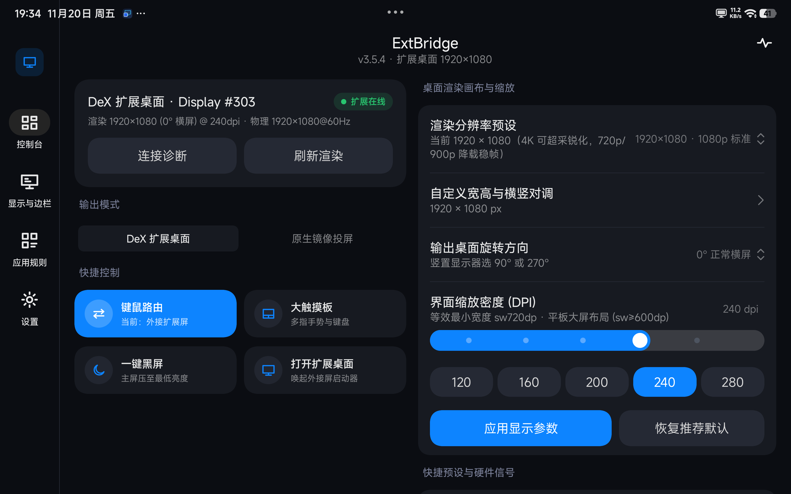

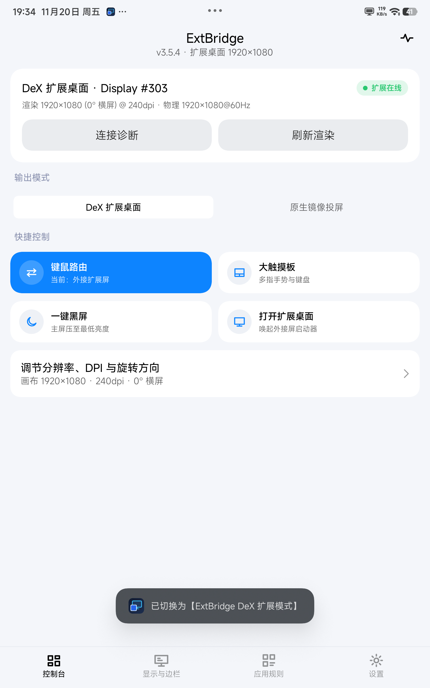

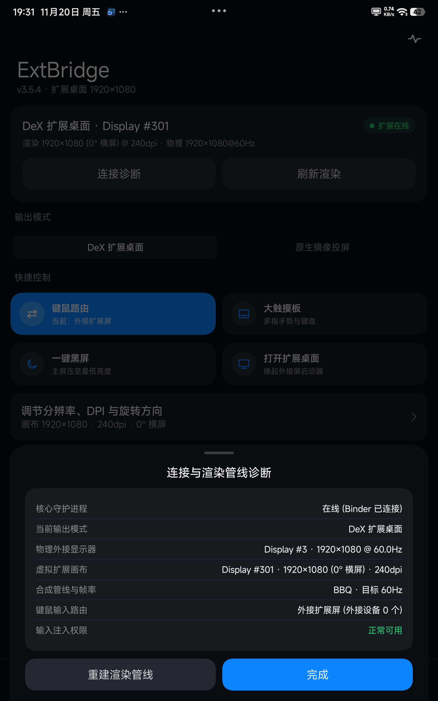

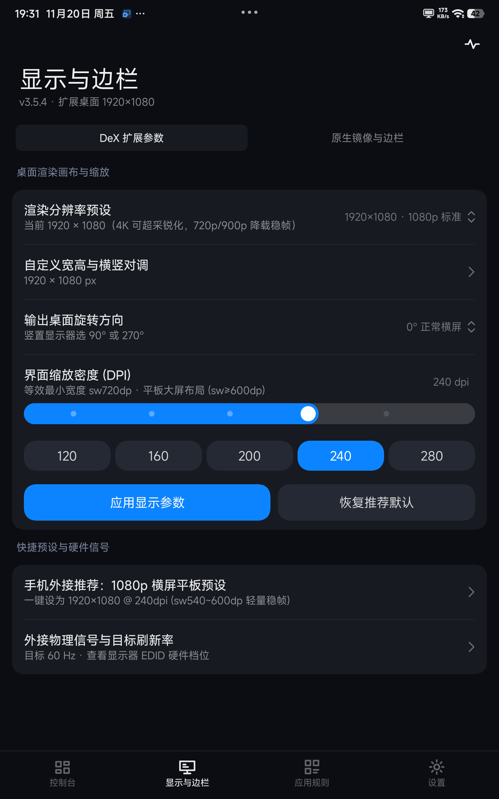

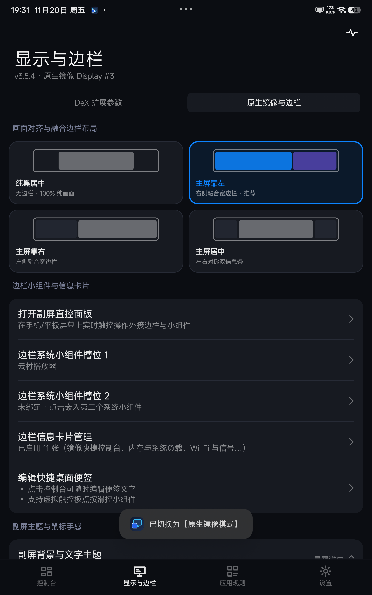

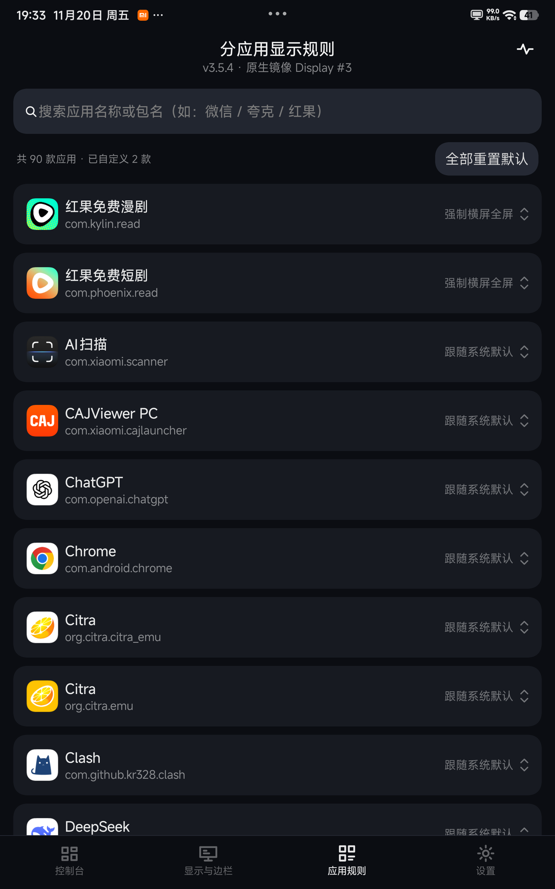

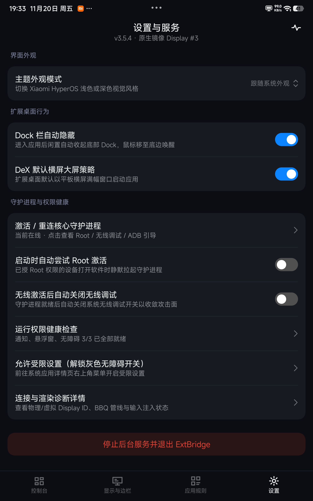

### 3.1 页面一：`控制台`（日常高频操作一屏搞定）
- **状态主卡**：实时显示当前工作模式、外接虚拟画布 `Display ID`、渲染分辨率/旋转/DPI 与显示器物理信号（如 `物理 2560×1440@60Hz`）。
  - **「连接诊断」**（或右上角波形图标）：打开管线诊断抽屉，查看 Binder 连接状态、BBQ 合成管线、已识别外接键鼠个数（如 `外接设备 4 个`）以及 `INJECT_EVENTS` 输入注入权限是否正常。
  - **「刷新渲染」**：当外接显示器刚唤醒或需要重同步图层时，一键无损重建渲染管线。
- **「输出模式」胶囊切换器**：一键在 **`DeX 扩展桌面`** 与 **`原生镜像投屏`** 两大核心模式间实时切换。
- **「快捷控制」`2×2` 澎湃磁贴**：
  1. **`键鼠路由`**：连接了蓝牙/USB 实体键鼠时，蓝色高亮代表键鼠绑定在**外接扩展屏**，灰色代表切回**本机内屏**，点击即切。
  2. **`大触摸板`**：将手机/平板屏幕变为带滚轮、三键与远程输入法的全屏触摸板。
  3. **`一键黑屏`**：将平板/手机主屏压至硬件最低亮度 `1` 并盖上纯黑防误触遮罩，外接屏继续正常观影办公（双击主屏即恢复）。
  4. **`打开扩展桌面` / `副屏直控`**：DeX 模式下点击将外接屏切回桌面启动器；原生镜像模式下自动变为 **`副屏直控`**，用手指在平板屏幕上直接操控外接屏黑边侧边栏。

### 3.2 页面二：`显示与边栏`（精细调整画质、旋转与镜像边栏）
顶部可在 **`DeX 扩展参数`** 与 **`原生镜像与边栏`** 两个子面板间切换（平板横屏首页右侧也会直接嵌入当前模式的面板）：

- **`DeX 扩展参数` 面板**：
  - **渲染分辨率预设**：提供 `3840×2160 (4K 超采样)`、`3440×1440 (21:9 准4K带鱼)`、`2560×1600`、`2560×1440 (2K 推荐)`、`2560×1080 (21:9 带鱼)`、`1920×1200`、`1920×1080`、`1600×900`、`1280×720 (低负载省电)` 等预设。
  - **自定义宽高与横竖对调**：支持自由输入任意宽高像素（范围 `640 ~ 4096`），并支持一键 `⇄ 对调宽高`。
  - **输出桌面旋转方向**：支持 `0° 正常横屏`、`90° 竖屏顺时针`、`180° 倒置横屏`、`270° 竖屏逆时针`。外接竖置（立式副屏）显示器时选择 `90°` 或 `270°`，系统会自动重建纵向虚拟画布（如 `1440×2560`）满屏铺满不留黑边，并将已打开的外接屏应用无缝迁移过去。
  - **界面缩放密度 (DPI)**：滑动条带关键点吸附与快捷胶囊（`120 / 160 / 200 / 240 / 280`），副标题会**实时换算等效最小宽度 `swDp`**（当 `sw >= 600dp` 时自动触发安卓应用的平板双栏/大屏 UI 布局；DPI 越小显示内容越多，DPI 越大字号图标越大）。
  - **「应用显示参数」与「恢复推荐默认」**：修改完分辨率/旋转/DPI 后点击蓝色 **「应用显示参数」** 立即生效；点击 **「恢复推荐默认」** 会自动读取当前显示器的 EDID 最高原生宽屏档位并匹配最佳 DPI（例如 2K 屏自动恢复 `2560×1440 @ 240dpi`）。
  - **高级物理信号与帧率抽屉**：展开底部高级卡片可查看显示器汇报的全部硬件 EDID 模式列表并尝试指定目标帧率。

- **`原生镜像与边栏` 面板**：
  - **`2×2` 画面对齐与融合边栏布局卡片**：直观显示灰白/蓝紫微缩屏幕示意图——`纯黑居中`（关闭边栏）、`主屏靠左`（右侧融合宽边栏，推荐）、`主屏靠右`（左侧融合宽边栏）、`主屏居中`（左右对称双翼信息条），点击即实时无缝换边。
  - **边栏系统小组件槽位 1 / 2**：点击即可从本机已安装应用中挑选任意桌面小组件（如网易云音乐「云村播放器」、系统天气、滴答清单等）嵌入外接副屏，并为每个槽位独立设置 **5 档显示比例锁定**（`自动原比例 / 方形 1:1 / 竖屏 3:4 / 宽屏 16:9 / 铺满槽位`），彻底杜绝小组件在窄长侧边栏中被拉伸变形。
  - **边栏信息卡片管理**：打开抽屉自由勾选/取消 14 款内置信息卡，并通过上下箭头调整显示先后顺序。
  - **视觉主题、快捷便签与副屏光标速度**：一键切换 `极夜深蓝`、`OLED纯黑`、`晨雾浅白`、`赛博紫青`、`翡翠墨绿`、`暖暮琥珀` 或自定义 `#RRGGBB` 纯色；随时修改边栏便签文字；调节副屏鼠标倍速（`0.9x 精细 ~ 3.4x 飞快`）。

### 3.3 页面三：`应用规则`（解决竖屏短剧/工具 App 比例痛点）
独立一级列表页，顶部支持按**应用名称或包名**实时搜索，已配置自定义规则的应用会自动置顶（带右侧 **「全部重置默认」** 按钮）。每个应用可在右侧下拉框选择三种模式：
1. **`跟随系统默认`（推荐绝大多数应用）**：零干预启动，微信、夸克、哔哩哔哩、WPS 等原生支持大屏/横屏的应用自动满屏运行。
2. **`强制横屏全屏`（适合红果免费短剧、漫剧等死锁竖屏的视频 App）**：通过逐项 `am compat` 精准解锁应用方向与宽高比限制，使其在外接屏以 `2560×1440` 满幅横屏展示（修改后会自动重启目标应用至外接屏生效）。
3. **`竖屏居中兼容`（适合拼多多、计算器等纯竖屏排版工具）**：保持舒服的手机竖屏比例在外接屏居中运行，防止图片和按钮被过度拉宽。

### 3.4 页面四：`设置`（外观、自动化与安全退出）
- **主题外观模式**：支持 `跟随系统外观`、`澎湃浅色模式`、`澎湃深色模式` 实时切换。
- **Dock 栏自动隐藏**：开启后进入应用无操作闲置约 `2.6 秒`，外接屏底部 Dock 自动收起为细指示条；鼠标移至底边或轻触即刻弹起。
- **DeX 默认横屏大屏策略**：控制外接扩展屏容器是否默认锁定横屏大屏方向并防系统工作台小窗劫持。
- **启动时自动尝试 Root 激活** / **启动时自动 Shizuku 激活**：按需开启开机后的静默自激活（Shizuku 优先，其次 Root）。
- **红色「停止后台服务并退出 ExtBridge」按钮**：安全恢复主屏亮度、解绑外接键鼠、销毁虚拟屏并彻底关闭后台守护进程与前台服务。

---

## 4. 模式一：DeX 独立扩展桌面、澎湃 Dock 与自由分屏

当输出模式处于 **「DeX 扩展桌面」** 时，平板/手机主屏与外接显示器完全独立，互不干扰（主屏可刷微信、记笔记或一键黑屏，外接屏独立运行桌面与双窗应用）。

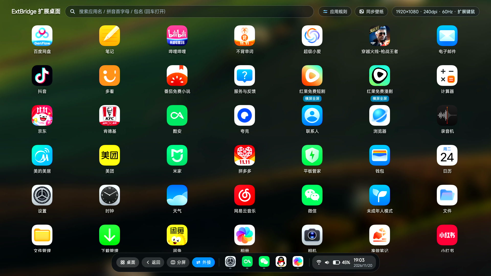

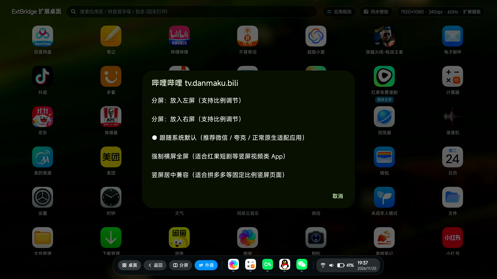

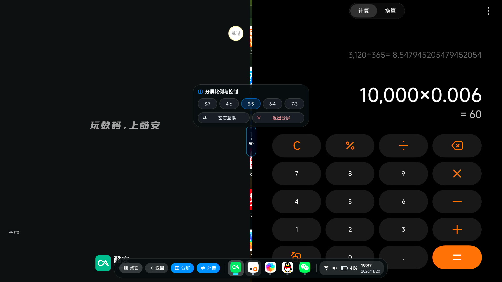

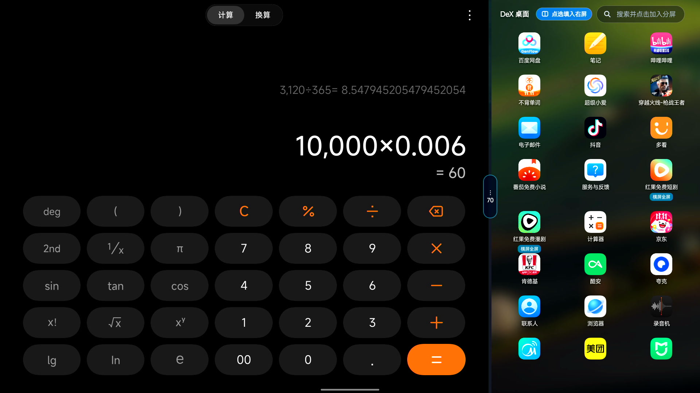

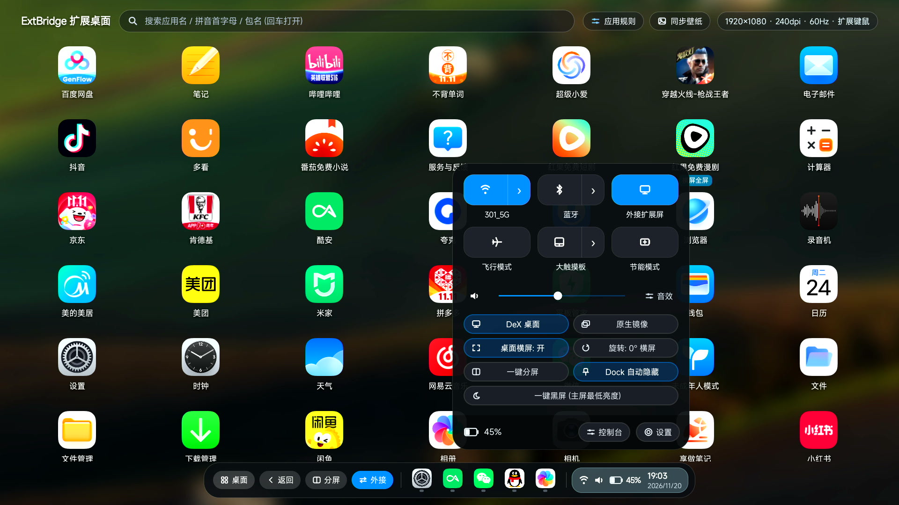

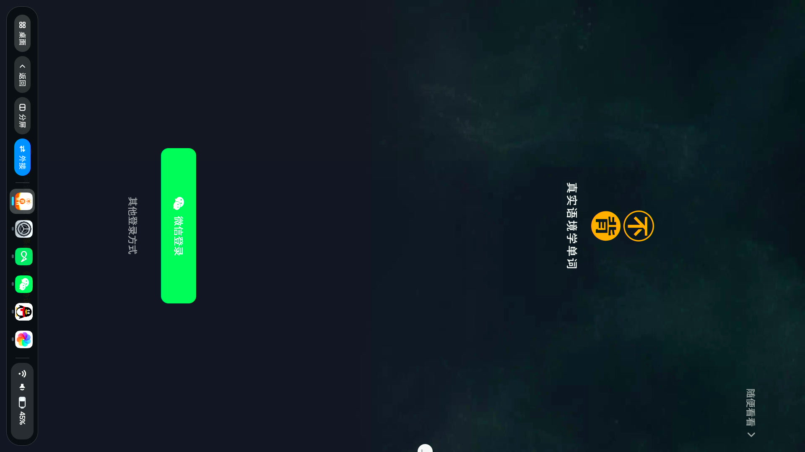


### 4.1 扩展桌面启动器 (`LauncherActivity`) 操作技巧
- **快速检索启动**：点击顶栏搜索框输入 **中文名、拼音首字母（如 `wyy` 搜网易云、`jsq` 搜计算器）或包名**，按回车键直接启动第一个匹配应用；按 `Esc` 或返回键清空搜索词（根桌面本身受防误关保护，按返回键绝不会把桌面黑掉）。
- **顶栏快捷按钮**：右侧提供 **`应用规则`**（在主屏唤起规则页）、**`同步壁纸`**（主屏换壁纸后一键重新采样毛玻璃背景）及实时状态徽标（`2560×1440 · 240dpi · 120Hz · 扩展键鼠`）。
- **图标长按 / 鼠标右键菜单**：对任意应用图标**鼠标右键或长按**即可弹出快捷菜单（见上方幻灯片第 2 张），可直接将该应用 **`放入左屏 / 右屏`**（竖屏时自动变为 **`放入上屏 / 下屏`**），或就地修改该应用的横竖屏兼容策略。

### 4.2 底部澎湃 Dock 栏与控制中心浮窗 (`BridgeService`)
- **左侧功能键区**：
  - `桌面`：将当前前台窗口平滑微弧收缩退回后台并回到扩展桌面（带 HyperOS 2.0 级窗口 → 图标舞台收缩动画）。
  - `返回`：向外接屏当前焦点窗口发送返回键。
  - `分屏`：未分屏时一键将最近两个外接屏应用自动拼成 `50:50` 分屏；已分屏时点击呼出分屏比例/互换/退出菜单。
  - `外接 / 内屏`：蓝色 `外接` 表示物理键鼠归外接屏使用，点击可随时切回平板内屏。
- **中部运行任务图标区**：
  - 图标下方带**亮色指示点**代表当前正在外接屏前台显示：**单击前台图标**会将其最小化收起回桌面；**单击后台图标**会从该图标位置弹性展开恢复至前台；**鼠标右键或长按任务图标**可弹出气泡菜单执行 `放入左/右分屏` 或 `✕ 关闭应用`。
- **右下角状态胶囊 & 控制中心浮窗**：
  - 点击右下角 `Wi-Fi / 音量 / 电量 / 时间` 区域展开 **澎湃深色毛玻璃控制中心**，内含 Wi-Fi / 蓝牙 / 键鼠路由 / 大触摸板 / 飞行模式 / 节能模式快捷磁贴、**媒体音量滑块**、`DeX ↔ 原生镜像` 切换、`桌面横屏`、`屏幕旋转`、`一键分屏`、`Dock 自动隐藏` 以及底部的 **`一键黑屏 (主屏最低亮度)`**。

### 4.3 自由分屏模式全流程操作
1. **如何进入分屏**：
   - **方法 1（最快）**：先后打开两个应用，点击底部 Dock 的 **`分屏`** 按钮（或控制浮窗的「一键分屏」），自动并排拼屏。
   - **方法 2（指定左右）**：在桌面右键/长按第一个应用选 **`分屏：放入左屏`**，此时右半屏会自动嵌入半屏桌面供你点选第二个应用，点击任意图标即自动填满右半屏！
2. **如何调比例、互换与退出**：
   - **自由无级拖拽**：按住两窗中间的半透明胶丸分割条（显示当前百分比，如 `:50`、`:35`）左右或上下拖动，松手即按 **`25% ~ 75%`** 任意比例重排双窗。
   - **快捷菜单与立体互换**：轻点一次中央胶丸分割条（或 Dock `分屏` 键），弹出预设条支持一键切 `3:7 / 4:6 / 5:5 / 6:4 / 7:3`、点击 **`⇄ 互换`** 立体交叉对调左右窗口位置，或点击 **`✕ 退出`** 让主窗口无黑边平滑铺满全屏。

### 4.4 平板/手机主屏「一键黑屏」省电护眼说明
在外接屏长时间办公或看剧时，在主控台、大触摸板或外接屏 Dock 控制浮窗点击 **「一键黑屏」**：
- 主屏立即覆盖全黑防误触层并将硬件背光压至最低值 `1`（修改前会先将当前亮度与自动亮度模式以 `fsync` 原子写入 `/data/local/tmp/extbridge_dim.bak`）。
- **如何唤醒恢复**：**在平板/手机主屏任意位置快速双击两下**，或按电源键锁屏再解锁，或拔掉显示器 / 退出服务，主屏均会立即撤除遮罩并精准恢复进入前的原始亮度（即便遇到极端断电/强杀崩溃，下次启动守护进程也会自动检测备份自愈恢复亮度）。

---

## 5. 模式二：增强原生镜像副屏、桌面小组件与副屏直控

当你想在平板主屏手写记笔记、打游戏或演示操作，同时投屏到大显示器观看时，切换到 **「原生镜像投屏」** 模式——ExtBridge 会将传统 `16:10 / 3:2` 平板投射到 `16:9` 显示器多出来的黑边改造成**零串屏硬件裁剪的高颜值信息副屏与桌面小组件停靠栏**。

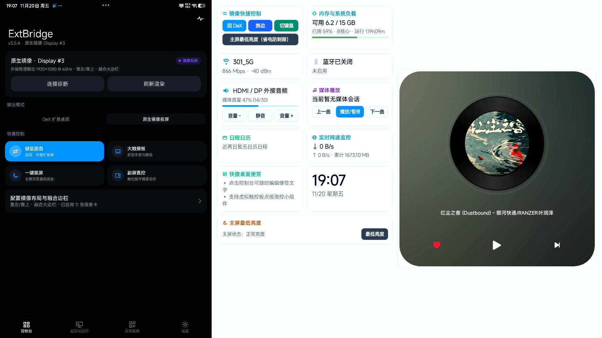

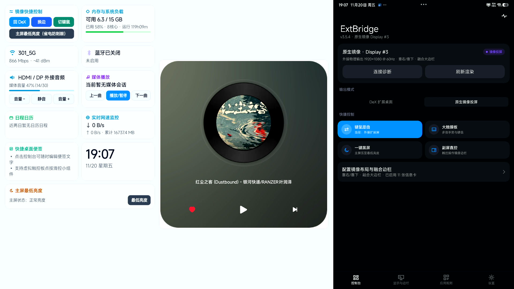

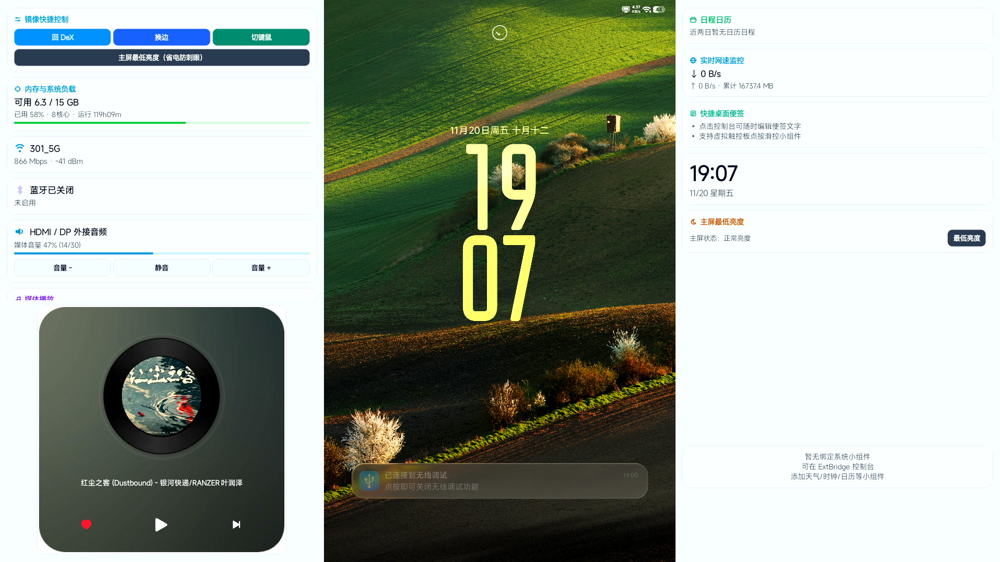

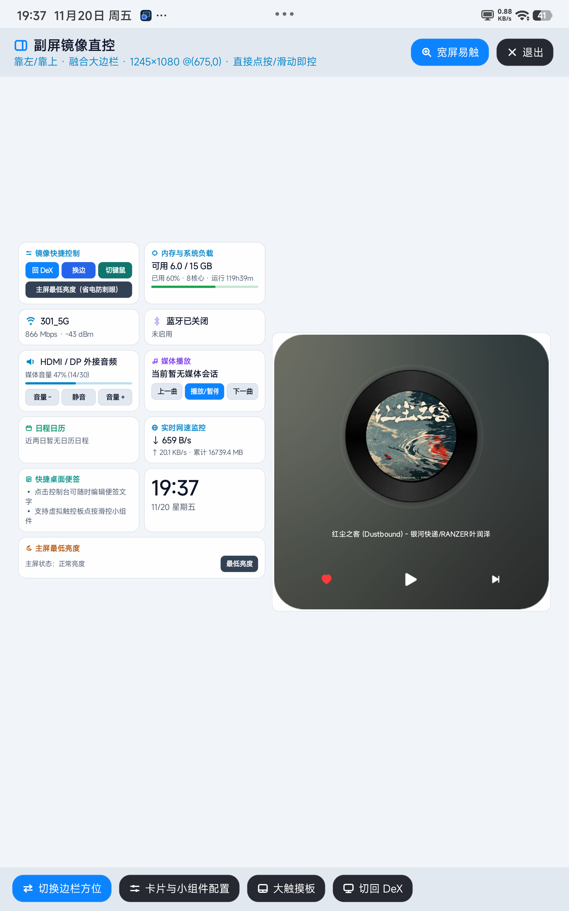

### 5.1 四种镜像布局形态对照
| 模式编号 | 布局名称 | 画面与黑边分配效果 | 推荐场景 |
| :---: | :--- | :--- | :--- |
| **`Mode 2`** | **主屏靠左 · 右侧融合宽边栏** | 主屏画面紧贴左侧，把左右两条窄黑边合并为右侧一条宽裕的信息与小组件栏 | 默认推荐，符合右手视线与鼠标右移直达习惯 |
| **`Mode 1`** | **主屏靠右 · 左侧融合宽边栏** | 主屏画面紧贴右侧，左侧合并为完整宽信息栏 | 适合显示器放在身体右侧或偏好左栏仪表盘 |
| **`Mode 3`** | **主屏居中 · 左右双翼对称边栏** | 主屏严格居中，左右两侧黑边对称分布信息卡片与双槽位小组件 | 适合 21:9 超宽带鱼屏或对称控观影环境 |
| **`Mode 0`** | **纯黑居中（无边栏）** | 关闭信息副屏，仅保留纯粹无遮挡的原生镜像画面 | 沉浸式全黑环境观影或专注演示 |

### 5.2 内置 14 款预设信息与交互卡片一览
- **可直接点击交互的 5 张控制卡**：
  1. **`镜像快捷控制`**：顶部直接点按 `回 DeX`、`换边`（循环切换左/右/双翼布局）、`切键鼠`、`主屏最低亮度 (省电防烧屏)`。
  2. **`音频通道与音量`**：实时显示当前音频输出设备（如 `HDMI / DP 外接音频`），直接点击 `音量 -` / `静音` / `音量 +`。
  3. **`媒体播放与切歌`**：自动识别当前播放音乐/视频 App（如网易云音乐、B 站）与歌名歌手，直接点击 `上一曲` / `播放/暂停` / `下一曲`。
  4. **`专注番茄钟`**：内置 25 分钟番茄工作法倒计时，直接在副屏点击 `开始 / 暂停` 与 `重置`。
  5. **`主屏最低亮度`**：底部独立省电护眼开关卡片，一键压低/恢复主屏背光。
- **实时状态监测的 9 张仪表卡**：`大数字时钟`、`日历与近两日日程`、`电池温压与充放电状态`、`内存可用量与系统运行负载`、`Wi-Fi SSID / Mbps 速率 / dBm 强度`、`实时上下行网速监控`、`蓝牙与已连外设`、`机身可用存储与亮度百分比`、`快捷桌面便签`。

### 5.3 如何操控镜像副屏上的卡片与小组件？（三种方式）
1. **外接实体鼠标无缝跨屏（自动边缘接管）**：
   - 当平板连着蓝牙/USB 鼠标时，只需将主屏上的鼠标指针**自然往副屏所在的那一侧屏幕边缘继续滑出去**，指针就会无缝跨入外接显示器的副屏边栏区域（支持左键点击、滚轮上下翻动卡片列表、右键返回）；
   - 想把鼠标移回主屏？只需**往主屏画面方向滑回过界**，或**用手指轻触一下平板主屏**，或按键盘 **`Esc`**，指针即毫秒级无跳变回到主屏！
2. **无外置键鼠时：打开主屏「副屏镜像直控」(`SideControlActivity`)**：
   - 在主控台点击 **`副屏直控`** 磁贴（见上方幻灯片第 4 张），外接副屏会被实时投射到平板主屏中央：直接用手指点按、上下滑动即可操作所有预设按钮与第三方音乐小组件！
   - 右上角点击 **`宽屏易触`** 可等比放大窄边栏方便手指精准点按；底部提供 **`切换边栏方位`**、**`卡片与小组件配置`**、**`大触摸板`** 与 **`切回 DeX`** 一键直达。
3. **通过「虚拟大触摸板」跨屏操控**：在 `TouchpadActivity` 中同样可以驱动光标点按副屏组件。

---

## 6. 虚拟大触摸板与远程中英文键盘输入

不带实体键鼠出门时，在主控台或通知栏点击 **「大触摸板」**，平板或手机瞬间化身为支持完整多指手势与中英文文字直传的无线触控板：

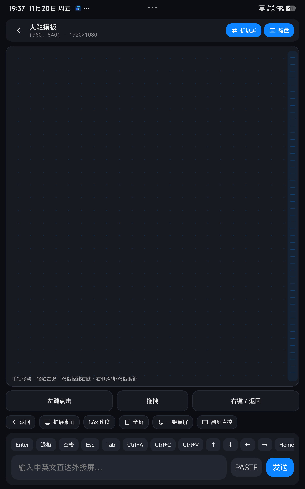

### 6.1 触控手势与底部拟真三键说明
| 手势 / 按键 | 对应外接屏动作 | 细节与智能场景说明 |
| :--- | :--- | :--- |
| **单指在点阵区滑动** | 移动外接屏光标 | 顶部胶囊实时显示当前像素坐标，支持底部 `0.6x ~ 2.4x` 五档移速循环调节 |
| **单指轻触点阵区 / `左键点击`** | 鼠标左键单击 | 点击图标、按钮、进度条 |
| **双指同时轻触 / `右键 / 返回`** | **智能右键菜单或系统返回** | 光标停在 DeX 桌面应用图标或底部 Dock 任务图标上时**弹出右键上下文菜单**；控制浮窗展开时**优先收起浮窗**；在其余任何外接屏应用内点击则**精准执行跨屏 `返回`（`KEYCODE_BACK`）** |
| **双指上下滑动 / 右侧刻度滑轨单指滑动** | 鼠标滚轮上下滚动 | 浏览长网页、信息流、聊天记录无需双指也可单手拇指搓右侧滑轨滚动 |
| **中间 `拖拽` 按钮** | 左键长按拖拽锁定开关 | 点亮后进入按住左键状态，单指滑动即可拖拽分屏胶丸手柄、进度条或框选内容，再点一次（或退出触控板时）自动顺序释放绝不卡键 |

### 6.2 远程键盘与快捷键栏（点击右上角 `键盘` 胶囊展开）
- **常用电脑快捷键一排直达**：内置 `Enter`、`退格`、`空格`、`Esc`、`Tab`、`Ctrl+A`（全选）、`Ctrl+C`（复制）、`Ctrl+V`（粘贴）、`↑ / ↓ / ← / →` 四向方向键与 `Home` 键。
- **中英文文字远程输入**：
  - 点击底部 `输入中英文直达外接屏...` 输入框，使用平板/手机自己的拼音、五笔或语音输入法打字：
    - 输入**纯英文/数字/符号**后点 **`发送`**：直接通过底层键盘事件逐字高速注入外接屏当前输入框；
    - 输入**包含中文的句子**后点 **`发送`**（或直接点 **`PASTE`**）：自动写入系统剪贴板并向外接屏焦点输入框发送粘贴指令，轻松在外接屏微信、浏览器、搜索框中输入大段中文！

---

## 7. ADB / Shizuku / 自动化快捷广播指令手册

`ControlReceiver` 支持通过 ADB Shell、Shizuku 或 Root 自动化脚本（如支持 Shell 模式的 Tasker / MacroDroid）发送显式广播控制所有核心功能。

> [!WARNING]
> **安全鉴权说明**：为防止零权限恶意第三方应用在后台劫持外接屏或伪造点击，`ControlReceiver` 绑定了系统签名级权限 `android.permission.INJECT_EVENTS`——通过 `adb shell am broadcast`、Shizuku 或 Root 执行时天然拥有该权限可直接调用；若普通自动化 App 使用无权限常规广播则会收到 `Permission Denial`，请在 Tasker / MacroDroid 中勾选 **「使用 Root / ADB Wifi / Shizuku 运行 Shell 命令」**。

| 广播 Action 名称 | 可选 Extra 参数 | 功能说明 |
| :--- | :--- | :--- |
| `com.extbridge.helper.TOGGLE_MIRROR` | `--ei mode 0/1`（省略则翻转）<br/>`--ei side_mode 0/1/2/3` | 在 DeX 扩展桌面 (`0`) 与原生镜像模式 (`1`) 间切换，可同时指定边栏布局 |
| `com.extbridge.helper.SET_MIRROR_SIDE_MODE` | `--ei side_mode 0/1/2/3`<br/>（或 `--ei mode 0/1/2/3`，省略则循环） | 切换镜像边栏：`0`=关闭，`1`=左侧宽栏，`2`=右侧宽栏，`3`=左右双翼 |
| `com.extbridge.helper.SET_ROTATION` | `--ei rotation 0/90/180/270`<br/>（或 `--ei rot 0/1/2/3`，省略则顺时针循环） | 切换 DeX 扩展屏旋转角度，横竖屏切换时自动满幅重建并迁移运行任务 |
| `com.extbridge.helper.TOGGLE_INPUT` | 无 | 在「外接扩展屏」与「平板内屏」之间切换物理键鼠路由 |
| `com.extbridge.helper.LAUNCH_EXT_HOME` | 无 | 将外接屏当前窗口收起并返回 DeX 桌面主页 |
| `com.extbridge.helper.SPLIT_ACTION` | `--ei action <1~6>`、`--ei arg <比例>`、`--es pkg <包名>` | 分屏控制：`3`=快速拼屏/退出，`4`=设比例(`arg=25~75`)，`5`=左右互换，`6`=退出分屏 |
| `com.extbridge.helper.SET_DOCK_AUTO_HIDE` | `--ez auto_hide true/false`<br/>（或 `--ez enable true/false`） | 开启或关闭外接屏底部 Dock 栏自动隐藏 |
| `com.extbridge.helper.REBUILD` | 无 | 强制刷新重建外接显示渲染管线 |
| `com.extbridge.helper.STATE_SYNC` | 无 | 立即同步守护进程与客户端状态 |
| `com.extbridge.helper.EXIT_ALL` | 无 | 安全恢复主屏亮度、解绑外接键鼠并彻底退出全部服务与守护进程 |

**常用命令一键复制示例：**
```bash
# 1. 一键切到原生镜像并启用左侧合并宽边栏
adb shell am broadcast -n com.extbridge.helper/.ControlReceiver -a com.extbridge.helper.TOGGLE_MIRROR --ei mode 1 --ei side_mode 1

# 2. 一键切回 DeX 独立扩展桌面
adb shell am broadcast -n com.extbridge.helper/.ControlReceiver -a com.extbridge.helper.TOGGLE_MIRROR --ei mode 0

# 3. 将外接屏旋转为 90° 立式竖屏副屏（再设 0 恢复横屏）
adb shell am broadcast -n com.extbridge.helper/.ControlReceiver -a com.extbridge.helper.SET_ROTATION --ei rotation 90

# 4. 安全恢复亮度并彻底停止退出 ExtBridge
adb shell am broadcast -n com.extbridge.helper/.ControlReceiver -a com.extbridge.helper.EXIT_ALL
```

---

## 8. 常见问题排查（FAQ）与环境还原指南

1. **Q：大触摸板或副屏鼠标能看到光标移动，但点击图标没反应？**
   - **A**：这是小米 / Redmi HyperOS 未开启模拟点击权限的表现。请进入 **设置 → 更多设置 → 开发者选项**，向下翻找到 **「USB 调试（安全设置）」** 并允许（需插卡登录小米账号完成倒计时确认），开启后立即生效无需重启。
2. **Q：在外接屏桌面点击某个 App 图标，有按下动画但没有窗口弹出来？**
   - **A**：检查主控台「连接诊断」确认守护进程在线；若刚重装过软件，重新跑一次激活流程即可自动补授小米后台弹窗权限（`MIUIOP 10021`）。
3. **Q：为什么在主控台把渲染分辨率改成了 `1080p` 或 `4K`，显示器自带 OSD 菜单里依然显示 `2560×1440@60Hz`？**
   - **A**：部分小米/MTK 正式版固件由系统底层 `DisplayModeDirector` 锁死了物理 HDMI/DP 握手档位；但 ExtBridge 调节的 **`VirtualDisplay` 实际渲染画布分辨率 100% 真实生效**——调低至 `720p/1080p` 可实打实降低 GPU 渲染负载与发热，调高至 `4K` 可实现超采样文字锐化，调整宽高比或 `90°` 竖屏旋转均由硬件图层矩阵无损合成输出。
4. **Q：开启了小米平板自带的「工作台模式（无界桌面）」，扩展屏应用会变成拖不动的小窗吗？**
   - **A**：不会。`v3.5.3` 已内置全链路防小窗劫持保护，会自动将扩展屏非分屏任务锁定在标准全屏容器内，无需手动关闭平板的工作台模式。
5. **Q：镜像副屏点击网易云音乐等第三方小组件后，鼠标指针会乱跳或副屏花屏串屏吗？**
   - **A**：`v3.5.3` 已通过 `ExtMir0Clip` + `ExtMirrorSide` 双向硬件像素裁剪、`PixelFormat.OPAQUE` 无空窗换窗、焦点回正脉冲及 `35ms` 误入任务瞬时迁回主屏彻底根治，可放心点按任何小组件。
6. **Q：使用「一键黑屏」期间如果平板突然死机重启或后台被强杀，开机后屏幕会一直很暗或外接键鼠失灵吗？**
   - **A**：不会。每次守护进程启动时都会先无条件解绑残留外接键鼠关联，并自动检查 `/data/local/tmp/extbridge_dim.bak` 恢复进入黑屏前的屏幕亮度；若尚未拉起守护进程，也可直接下拉系统控制中心拖动亮度条立即恢复。
7. **Q：Shizuku 激活提示「服务未运行」或「尚未授权」？**
   - **A**：「服务未运行」表示 Shizuku 服务未启动（请打开 Shizuku 应用按引导启动，开机后需手动重启一次，已 Root 设备可用 Root 方式启动）；「尚未授权」请回到 ExtBridge 激活抽屉点击 **「授权 Shizuku」** 并在 Shizuku 弹窗中允许。若设备上未安装 Shizuku，可改用下方 **电脑 ADB** 或 **Root** 方式激活。
8. **Q：不想用了，如何 100% 干净还原系统设置并卸载？**
   - **A**：① 若曾设置过单应用「强制横屏全屏」，先在 **应用规则** 页点击右上角 **「全部重置默认」**（清除 `am compat` 规则）；② 在 **设置** 页划到底部点击红色 **「停止后台服务并退出 ExtBridge」**；③ 正常卸载 App 即可，系统分区与开发者选项零残留。

